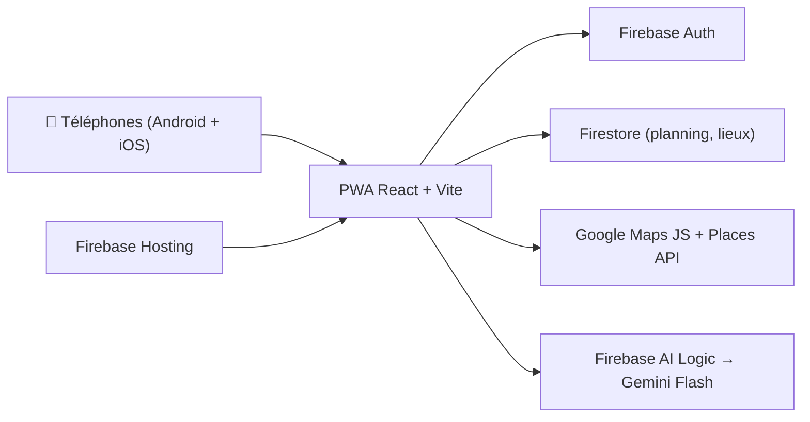

# 🇯🇵 App Voyage Japon — Plan de développement

> Objectif : une application privée (toi + tes proches) pour planifier le voyage au Japon, utilisable sur **Android et iOS**, avec un coût **0 €** si possible.

> [!NOTE]
> Les quotas gratuits cités ci-dessous sont ceux connus à la rédaction ; ils changent régulièrement. On les revérifiera sur les pages de tarification officielles avant de créer les comptes.

---

## 1. Le point bloquant : la distribution sur iOS

Partager « un fichier d'installation en direct » fonctionne très bien sur **Android** (fichier `.apk`), mais **pas sur iOS** :

| Méthode de distribution | Android | iOS | Coût |
|---|---|---|---|
| Fichier `.apk` partagé (WhatsApp, Drive…) | ✅ Simple | ❌ Impossible | Gratuit |
| iOS « Ad Hoc » (fichier `.ipa` + UDID de chaque iPhone) | — | ✅ Max 100 appareils | **99 $/an** (Apple Developer) |
| TestFlight | — | ✅ Lien d'invitation | **99 $/an** |
| Xcode + Apple ID gratuit | — | ⚠️ Nécessite un Mac, l'app expire tous les **7 jours** | Gratuit |
| **PWA** (site web installable sur l'écran d'accueil) | ✅ | ✅ | **Gratuit** |

### 👉 Recommandation : **PWA (Progressive Web App)**
- Un seul lien à partager → chacun fait « Ajouter à l'écran d'accueil » → icône comme une vraie app, plein écran.
- Mises à jour instantanées pour tout le monde (pas de réinstallation).
- Fonctionne hors-ligne (utile au Japon sans réseau / en métro).
- Hébergement gratuit (Firebase Hosting, Netlify, Vercel…).

**Option évolutive** : développer avec **Expo (React Native)** qui produit à la fois un `.apk` Android natif *et* une version web/PWA. On garde ainsi la porte ouverte à une vraie app iOS si un jour tu prends le compte Apple à 99 $.

---

## 2. Stockage des données (sans base de données à toi)

| Option | Partage temps réel | Hors-ligne | Complexité | Gratuit | Verdict |
|---|---|---|---|---|---|
| **Fichier Excel partagé** (OneDrive via Microsoft Graph) | ❌ Conflits d'écriture | ❌ | Élevée (OAuth Microsoft) | ✅ | ❌ Déconseillé |
| **Google Sheets** (via API ou Apps Script) | ⚠️ Lent, pas de sync live | ❌ | Moyenne | ✅ | ⚠️ Possible, lisible par la famille |
| **Fichier JSON** (Drive / GitHub Gist) | ❌ Le dernier qui écrit écrase les autres | ❌ | Faible | ✅ | ❌ Risque de perte de données |
| **Firebase Firestore** (Google) | ✅ Synchro instantanée | ✅ Natif | Faible | ✅ Plan Spark | ✅ **Recommandé** |
| **Supabase** (PostgreSQL) | ✅ | ⚠️ | Moyenne | ✅ (projet mis en pause après 7 j d'inactivité) | 👍 Alternative |

### 👉 Recommandation : **Firebase (plan Spark gratuit, sans carte bancaire)**
- Firestore : ~1 Go de stockage, ~50 000 lectures et ~20 000 écritures/jour → **largement suffisant** pour un groupe de 5-10 personnes.
- **Firebase Auth** : connexion Google (ou lien par e-mail) pour que seuls tes proches accèdent aux données.
- **Firebase Hosting** : héberge la PWA gratuitement.
- **Firebase AI Logic** : appelle Gemini sans exposer de clé API (voir §4).
- Bonus : un bouton **« Exporter en Excel/CSV »** dans l'app pour garder le côté tableur.

---

## 3. Carte interactive & recherche de lieux

### Option A — Google Maps Platform (recommandée pour le Japon)
- Meilleures données au Japon : noms en japonais/anglais, horaires, notes, photos, temples, restaurants…
- Depuis mars 2025, le crédit de 200 $/mois a été remplacé par des **quotas gratuits mensuels par API** (ordre de grandeur : ~10 000 appels/mois pour les API « Essentials », ~5 000 pour les « Pro »).
- APIs utiles : **Maps JavaScript API** (carte), **Places API (New)** — Autocomplete + Place Details, éventuellement **Routes API**.
- ⚠️ **Carte bancaire obligatoire** pour activer le compte de facturation, même si tu restes dans le gratuit.
- 🛡️ Protections à mettre en place : plafonds de quota journaliers dans la console, alerte budget à 1 €, clé API restreinte à ton domaine.

### Option B — 100 % gratuit sans carte bancaire
- Carte : **OpenStreetMap** via **Leaflet** ou **MapLibre**.
- Recherche : **Nominatim** / **Photon** (gratuit, limité ~1 requête/s).
- Inconvénient : données moins riches (peu d'horaires, avis, photos).

### 👉 Choix proposé
Commencer avec **Google Maps + quotas plafonnés** (pour ton usage, tu resteras très loin des limites). Fallback possible vers OSM si tu ne veux pas renseigner de carte bancaire.

**Fonctionnalités carte :**
- Pins colorés par jour (Jour 1 = rouge, Jour 2 = bleu…) ou par catégorie (🍜 resto, ⛩️ temple, 🏨 hôtel, 🛍️ shopping).
- Filtre « afficher seulement le jour X ».
- Clic sur un pin → fiche du lieu + bouton « Ouvrir dans Google Maps » (itinéraire natif).
- Tracé du parcours de la journée.

---

## 4. Fonctionnalités IA Gemini

### Accès gratuit
- **Gemini API (Google AI Studio)** : free tier avec limites de requêtes/minute et /jour sur les modèles *Flash* — suffisant pour un usage familial.
- ⚠️ Sur le free tier, Google peut utiliser les requêtes pour améliorer ses produits → ne pas y mettre de données sensibles (passeports, etc.).
- ⚠️ Ne **jamais** mettre la clé API dans le code d'une PWA (elle serait visible par tous). Solution : **Firebase AI Logic + App Check**, qui appelle Gemini côté Google de manière sécurisée, compatible plan Spark.

### Idées de fonctionnalités IA
| Fonctionnalité | Description | Priorité |
|---|---|---|
| 🗓️ Générateur d'itinéraire | « 3 jours à Kyoto, temples + street food » → propose une journée type, ajoutable en 1 clic | ⭐⭐⭐ |
| 💡 Suggestions autour d'un lieu | « Que faire près de Shibuya le soir ? » | ⭐⭐⭐ |
| ✅ Optimisation de journée | Réordonne les lieux pour limiter les trajets, signale les journées trop chargées | ⭐⭐ |
| 🈯 Traducteur / phrases utiles | Traduction FR ↔ JP, lecture de menus via photo (multimodal) | ⭐⭐ |
| 💬 Assistant voyage | Chat contextuel connaissant votre planning (JR Pass, étiquette, météo…) | ⭐ |

Gemini peut renvoyer du **JSON structuré** → les suggestions se transforment directement en étapes du planning.

---

## 5. Stack technique proposée



| Couche | Choix | Coût |
|---|---|---|
| Front | **React + Vite + TypeScript**, plugin PWA (`vite-plugin-pwa`) | 0 € |
| UI | Tailwind CSS (design mobile-first) | 0 € |
| Carte | `@vis.gl/react-google-maps` | Quotas gratuits |
| Données | Firestore (sync temps réel + cache hors-ligne) | 0 € |
| Auth | Firebase Auth (Google) + liste blanche d'e-mails | 0 € |
| IA | Firebase AI Logic (Gemini Flash) | Free tier |
| Hébergement | Firebase Hosting (HTTPS inclus) | 0 € |

---

## 6. Modèle de données (Firestore)

```
trips/{tripId}
  ├─ name, startDate, endDate, members[] (emails autorisés)
  ├─ days/{dayId}
  │    └─ date, title, city, notes
  └─ places/{placeId}
       ├─ googlePlaceId, name, address, lat, lng, category
       ├─ dayId (nullable = « lieux à placer »), order, startTime
       ├─ notes, addedBy, budget
       └─ photoUrl, rating
```

---

## 7. Roadmap

> **Avancement (10/11/2026)** : phases 0 à 4 codées (le build passe), plus l'import Wanderlog par IA. Reste : créer les comptes (voir [SETUP.md](SETUP.md)), tester sur de vrais appareils, puis la phase 5.

| Phase | Contenu | Statut |
|---|---|---|
| **0. Setup** | Projet React/Vite PWA, config Firebase, règles Firestore, icônes | ✅ Code prêt – comptes à créer |
| **1. MVP planning** | Auth Google, création du voyage, jours, ajout/édition/réordonnancement (▲▼), déplacement entre jours | ✅ |
| **2. Lieux & carte** | Recherche Google Places (autocomplete), carte avec pins par jour, tracé du parcours, fiche lieu, liens Maps/itinéraire | ✅ |
| **3. Collaboratif & offline** | Sync temps réel, cache hors-ligne, « ajouté par », liste « idées à placer » | ✅ |
| **4. IA Gemini** | **Import Wanderlog** (PDF / texte / captures → jours + lieux géolocalisés), idées IA pour une journée | ✅ |
| **5. Finitions** | Tests iPhone + Android, export CSV ✅, découpage du bundle, ajustements UX | ⏳ |
| **6. (Optionnel)** | Budget partagé, checklist bagages, documents (billets), traduction / photo de menu, glisser-déposer | — |

---

## 8. Récapitulatif des coûts

| Poste | Coût |
|---|---|
| PWA + hébergement Firebase | **0 €** |
| Firestore + Auth | **0 €** |
| Gemini (free tier) | **0 €** |
| Google Maps / Places | **0 €** dans les quotas (CB requise) — ou OSM 0 € sans CB |
| App iOS native (optionnel) | 99 $/an |

---

## 9. Décisions

| Sujet | Décision |
|---|---|
| Plateforme | ✅ **PWA** (React + Vite) |
| Carte & lieux | ✅ **Google Maps Platform** (quotas plafonnés + alerte budget) |
| Stockage | ✅ **Firebase** (Firestore + Auth + Hosting) |
| Utilisateurs | ✅ **6 personnes** (liste blanche d'e-mails) |
| IA | ✅ **Gemini API free tier via Firebase AI Logic** (l'abonnement Google AI Pro ne fournit pas d'accès API — voir ci-dessous) |

### Abonnement Google AI Pro : à quoi sert-il ici ?
- ❌ **Ne finance pas** les appels Gemini faits *depuis l'application* : l'API Gemini est facturée séparément (AI Studio / Google Cloud). On reste donc sur le free tier, largement suffisant pour 6 personnes.
- ✅ **Utile en dehors de l'app** pour préparer le voyage : Deep Research (« itinéraire 14 jours Japon en avril »), Gems partagés (un « assistant voyage Japon » avec vos contraintes), NotebookLM (compiler guides, PDF, vidéos), Gemini dans Gmail/Drive pour retrouver les réservations.
- 💡 Possibilité future : un bouton « Exporter le planning en texte » pour le coller dans Gemini Pro et profiter du modèle le plus puissant.

### Encore ouvert
- Dates et villes approximatives du voyage (pour pré-remplir les jours)
- Fonctionnalités IA prioritaires (proposition par défaut : générateur d'itinéraire + suggestions autour d'un lieu)
